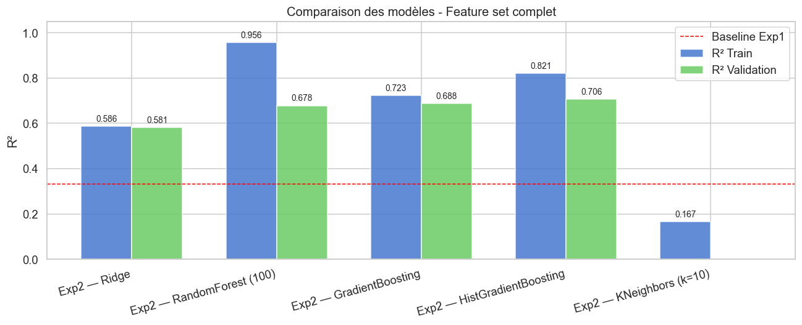
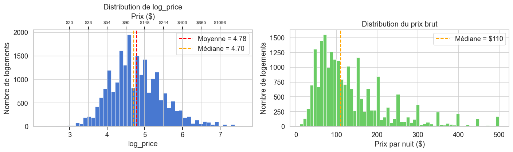
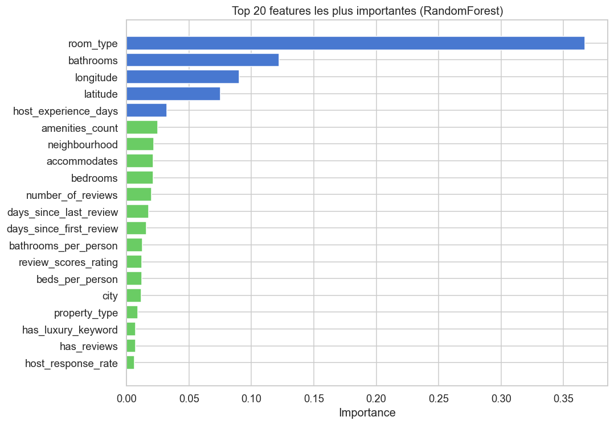
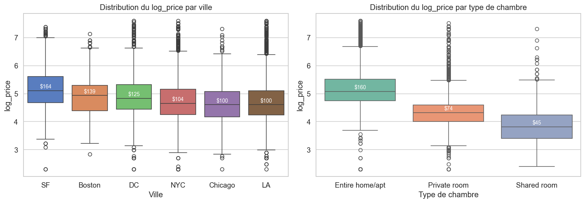
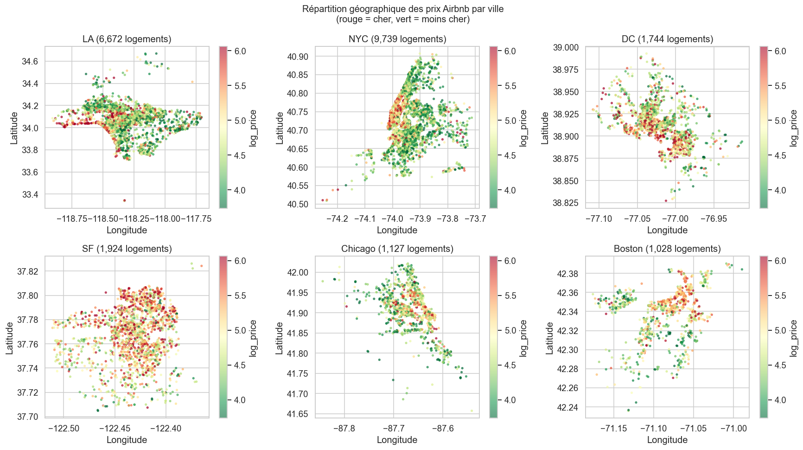
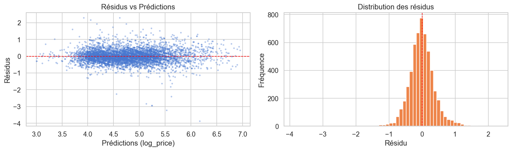

# Airbnb Price Prediction

Predicting the nightly price of an Airbnb listing from its characteristics (type, size, location, amenities, host and review history), using feature engineering and gradient boosting.

> University project for the *Data Analysis / Machine Learning* course, ESILV (A3, semester 2). Authors: Perkins & Benchimol.

|  |  |
|---|---|
| **Task** | Regression on `log_price` (natural log of the nightly price) |
| **Data** | 22,234 labelled listings, 6 US cities (NYC, LA, SF, DC, Chicago, Boston), 51,877 unlabelled listings to predict |
| **Metric** | R² |
| **Final model** | `HistGradientBoostingRegressor`, tuned with `RandomizedSearchCV` |
| **Result** | **R² = 0.708** on a held-out 25 % validation split (baseline: 0.332) |

## Results

All scores are R² on the same 75 / 25 train / validation split (`random_state=98`).

| Model | Features | R² train | R² validation |
|---|---|---|---|
| LinearSVR (course baseline) | 3 | 0.325 | 0.332 |
| Ridge | 49 | 0.587 | 0.581 |
| RandomForest (100 trees) | 49 | 0.956 | 0.678 |
| GradientBoosting | 49 | 0.723 | 0.688 |
| HistGradientBoosting | 49 | 0.821 | 0.706 |
| **HistGradientBoosting, tuned** | 49 | 0.780 | **0.708** |
| KNeighbors (k=10) | 49 | 0.167 | -0.029 |



What the numbers say:

- **Feature engineering is where the gain comes from.** Going from 3 raw features to 49 engineered ones takes R² from 0.33 to about 0.70. Hyperparameter tuning adds only about 0.002 on top, and the gap between the default and the tuned model is within noise.
- **RandomForest overfits heavily** (0.956 train vs 0.678 validation). HistGradientBoosting has the best validation score and a much smaller train/validation gap.
- **KNN fails** on 49 mixed-scale features (curse of dimensionality, and no feature scaling was applied).

### Why `log_price`

Raw prices are strongly right-skewed. Modelling the log makes the target close to normal and makes the loss reflect relative errors: being off by $10 matters far more on a $50 listing than on a $500 one.



### What drives the price

Room type, number of bathrooms, and location (latitude and longitude) dominate the RandomForest feature importances. City, size, amenity count and host experience follow.



Prices vary a lot by city and room type, and within each city by location:




The residuals of the final model are centred on zero with no obvious systematic bias:



*(Figure titles and labels are in French because the notebook is written in French.)*

## Approach

The pipeline is built from small classes, each with `fit_transform` (learns parameters on the training set) and `transform` (reuses them on new data):

| Step | What it does |
|---|---|
| `BasePreprocessor` | `t`/`f` flags to 0/1, `"90%"` to `90.0`, label-encodes categoricals, median imputation, adds `_is_null` flags for the two columns with about 22-25 % missing values |
| `AmenitiesEncoder` | Regex parser for the non-standard `{TV,"Wireless Internet",...}` format, amenity count, one-hot for the 20 most frequent amenities, drops the platform's `translation missing` entries |
| `DateFeatures` | Host seniority, days since first / last review relative to a fixed reference date, `has_reviews` flag |
| `TextFeatures` | Flag for premium keywords (luxury, penthouse, villa, ...) in the title or description |
| `GeoFeatures` | Groups neighbourhoods seen fewer than 5 times into `Other`, keeps latitude / longitude |
| Derived features | Beds per person, bathrooms per person |

Dropped columns: `id`, `zipcode` (redundant with coordinates and neighbourhood), raw `amenities`, `description`, `name`.

## Limitations and next steps

Things I would do differently with more time, and that are worth knowing when reading the scores above:

- **Mild leakage in the validation score.** The preprocessors (medians, label encoders, top-20 amenities) are fitted on the whole training file *before* the 75 / 25 split. The effect is probably small, but a `scikit-learn` `Pipeline` fitted inside the cross-validation loop would remove it.
- **Unfair setup for Ridge and KNN.** Both receive label-encoded categoricals and unscaled features, so their scores understate what a linear or distance-based model could do with one-hot encoding and scaling. Tree models are not affected.
- **No refit on all labelled data.** The submitted model was trained on the 75 % split only.
- **Text is under-used.** One keyword flag; TF-IDF or embeddings of the description are the obvious next step.
- **Single split for model comparison.** Comparisons in the table use one split; repeated K-fold would give error bars.
- **Notebook-only code.** The classes live in the notebook; moving them to a package with a train / predict script would make the project reusable.

## Run it yourself

The raw data comes from the course and is **not included** in this repository (`airbnb_train.csv` is 29 MB and `airbnb_test.csv` is 66 MB; both are git-ignored). To reproduce:

```bash
git clone https://github.com/lucaperkins/airbnb-prix-prediction.git
cd airbnb-prix-prediction
python -m venv .venv && source .venv/bin/activate
pip install -r requirements.txt
# put airbnb_train.csv and airbnb_test.csv in this folder, then:
jupyter lab airbnb_projet_PERKINS_BENCHIMOL.ipynb
```

Run all cells; the last ones write `MaPredictionFinale.csv` and validate its format.

If you only want to read the analysis, the notebook is committed with its outputs, so GitHub renders every table and figure without running anything.

## Repository layout

```
├── airbnb_projet_PERKINS_BENCHIMOL.ipynb   # EDA, feature engineering, modelling, final prediction
├── MaPredictionFinale.csv                  # predictions for the 51,877 test listings (id, logpred)
├── prediction_example.csv                  # submission format given by the course
├── requirements.txt
├── images/                                 # figures used in this README
└── docs/
    ├── DOCUMENTATION.md                    # detailed write-up (in French)
    ├── DOCUMENTATION.docx                  # same, Word version
    └── Explication.txt                     # original task brief and column list (in French)
```

## License

MIT, see [LICENSE](LICENSE). The dataset belongs to its original source and is not covered by this license.
